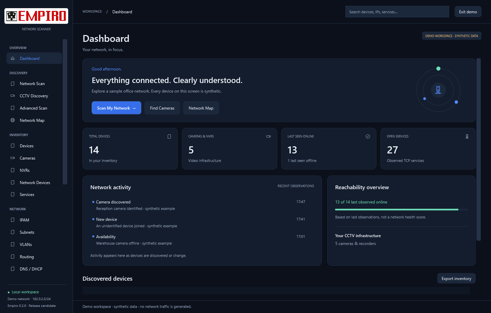

# Empiro Network Scanner

**A Windows network and CCTV discovery platform built with C#, .NET 10 and WPF.**

Discover responding devices, inspect identification evidence, organize inventory, view observed relationships, monitor reachability and export reports. This is a separate application from [Empiro IP Scanner](https://github.com/vineetkr/empiro-ip-scanner).



The screenshot shows fictional sample devices, not a live scan. [View all five screenshots](docs/SCREENSHOTS.md).

## Documentation

- [Portfolio case study and interview guide](docs/PORTFOLIO.md)
- [Architecture and technology](docs/ARCHITECTURE.md)
- [User guide and offline demonstration](docs/USER_GUIDE.md)
- [Development, testing and release preparation](docs/DEVELOPMENT.md)
- [Implemented scope and limitations](docs/STATUS.md)
- [Historical installer deployment instructions](docs/DEPLOYMENT.md)
- [Third-party notices](THIRD_PARTY_NOTICES.md)

## Features

- IPv4 address/CIDR scanning with bounded concurrency, cancellation and progressive results.
- ICMP, local ARP, optional TCP probing and HTTP/RTSP/SSH response identification.
- ONVIF WS-Discovery advertisements on a selected IPv4 interface.
- Evidence and confidence labels, notes, tags, favorites and searchable device inventory.
- SQLite persistence with transactional updates, schema checks and interrupted-session recovery.
- Network-map rendering, pan/zoom/drag and PNG export. Links require supplied relationship evidence; live LLDP/CDP/FDB collection is not implemented.
- IPAM observations, reachability monitoring, availability events and basic exposure review.
- CSV, JSON, text and printable HTML inventory exports; a separate command-line scanner.
- Light/dark themes and an explicit synthetic demo for offline presentations.

## Quick start

Use Windows x64 and .NET SDK 10.0.402 or a compatible patch selected by `global.json`. Run from the repository root:

```powershell
dotnet restore Empiro.sln
dotnet build Empiro.sln -c Release --no-restore
dotnet test Empiro.Tests/Empiro.Tests.csproj -c Release --no-build --no-restore
dotnet run --project Empiro.App -c Release --no-build -- --preview
```

`--preview` starts with 14 fictional devices, documentation-range addresses and synthetic identity/relationship evidence. It uses a separate demo data directory. Live scanning and monitoring are disabled while demo mode is active; selecting Exit demo explicitly changes mode within that workspace. Relaunch without `--preview` to use the normal live inventory.

For live use, omit `--preview`, choose an adapter and select Scan My Network or Find Cameras. Startup does not automatically scan a network.

## Build and package

`./build.ps1` restores, builds and runs tests. Add `-Publish` for a self-contained Windows x64 build. `-Dotnet` can specify an existing SDK executable. `packaging/Build-Installer.ps1` contains the historical WiX 5.0.2 MSI pipeline; see the development guide for prerequisites and release limitations.

## Scope and result quality

This is an evaluation release candidate, not a completed enterprise management platform. The [status document](docs/STATUS.md) explicitly lists missing features. No claim of production readiness, comprehensive vulnerability scanning or large-network throughput is made.

Use only on networks you own or are authorized to administer. An unanswered address is unobserved, not necessarily free or offline. RTSP alone does not prove a camera identity. ONVIF advertisements are not authenticated device verification. Multicast generally does not cross routers or isolated VLANs. Map links are evidence-based observations rather than inferred physical cables. Monitoring requires three consecutive failed probes before marking a device offline.

Live data is stored under `%LOCALAPPDATA%\Empiro`; preview-launch data uses `%LOCALAPPDATA%\Empiro-NetworkScanner-Demo`. Demo assets are rejected by live inventory persistence. Synthetic timings and device counts are illustrative, not performance results.

## License

Copyright (C) 2026 Vineet Kumar and contributors.

Licensed under **GPL-3.0-only**. See [LICENSE](LICENSE). Dependencies retain their own licenses; see [THIRD_PARTY_NOTICES.md](THIRD_PARTY_NOTICES.md). Compiled installers, local databases and SDKs are excluded from source control.
