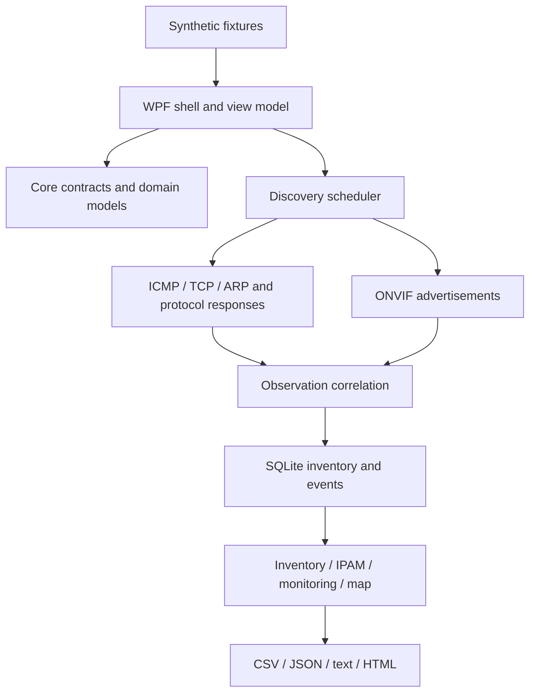

# Architecture and technology

## Stack

| Technology | Role |
|---|---|
| C# | Application, protocol, domain and test implementation |
| .NET 10 | Runtime and SDK; pinned SDK baseline in global.json |
| WPF / XAML | Windows interface, bindings, templates and resources |
| MVVM | Observable shell view model and commands |
| Microsoft.Extensions.Hosting / DI | Host lifecycle and service composition |
| Microsoft.Data.Sqlite | Local inventory, events and session storage |
| Serilog | Structured rolling file logs |
| xUnit | Regression and loopback integration tests |
| PowerShell / WiX | Build, publishing and MSI packaging |

The project targets .NET 10 and explicitly sets C# language version 12. It does not contain a web frontend or a cloud service.

## Modules

| Project | Responsibility |
|---|---|
| Empiro.App | WPF shell, view models, commands, theme, synthetic data and composition |
| EMPiro.Domain / EMPiro.Core | Asset/evidence models, contracts and scan configuration |
| EMPiro.Network / EMPiro.Discovery | Adapter/CIDR handling, ICMP/TCP/ARP and scan scheduling |
| EMPiro.CCTV | ONVIF WS-Discovery advertisement parsing |
| EMPiro.Inventory | Observation correlation and identity-change handling |
| EMPiro.Infrastructure | SQLite store, settings, Windows protected-data support |
| EMPiro.Topology / EMPiro.IPAM | Relationship evidence and address observations |
| EMPiro.Monitoring / EMPiro.Security | Reachability events and basic service exposure findings |
| EMPiro.Reporting / EMPiro.Plugins | Inventory export and provider extension contracts |
| Empiro.CLI / Empiro.Tests | Command-line workflow and automated checks |

## Scan and persistence flow

The UI validates IPv4 targets, limits and configured ports before starting bounded work. A bounded result channel, UI batching and throttled progress keep results from creating unlimited UI updates. Cancellation propagates through the asynchronous workflow, although synchronous Windows ARP calls can delay completion of in-flight work.

Correlation preserves observed identity and service evidence without inventing data for unknown responses. SQLite transactions store devices and resulting events together. Schema checks reject newer unsupported versions; startup recovers interrupted sessions. A workspace lock prevents concurrent instances from using the same workspace.

## Truthfulness of observations

The inventory currently keys assets by IP, rather than reconciling every interface of a multi-homed asset. A changed MAC can mean reuse or a conflict; it is not conclusive proof of simultaneous duplication. Map links require explicit neighbor evidence. The current build can process supplied LLDP/CDP/FDB evidence but cannot collect it live. Basic security findings describe exposed protocols; they are not CVE matches or exploitation results.

## Demo and screenshots

DemoData marks every example asset Synthetic. The SQLite store rejects synthetic assets; demo notes/favorites are kept in session. Preview launches use a distinct data directory, while screenshot renders use an ignored preview-data directory beneath the output folder. Demo network commands are guarded in the view model. Demo mode can be explicitly exited, so it is not a permanent sandbox for all subsequent user actions.

## Scaling path

Provider contracts and project separation support new discovery implementations. Further work would include hardware-tested protocol providers, persistent map layouts, better multi-address identity, concurrent monitoring, benchmarked scheduling and plugin trust/loading. These are planned improvements, not completed distributed or enterprise capabilities.
