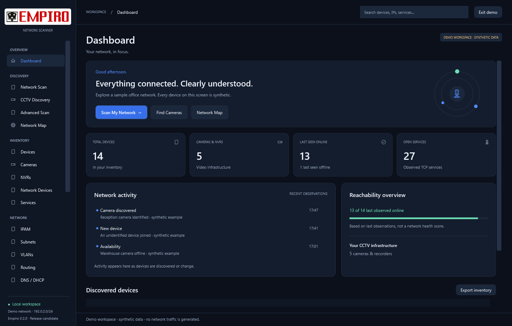
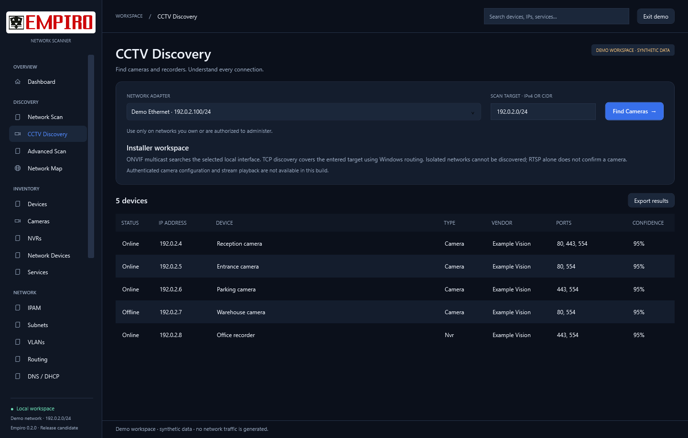
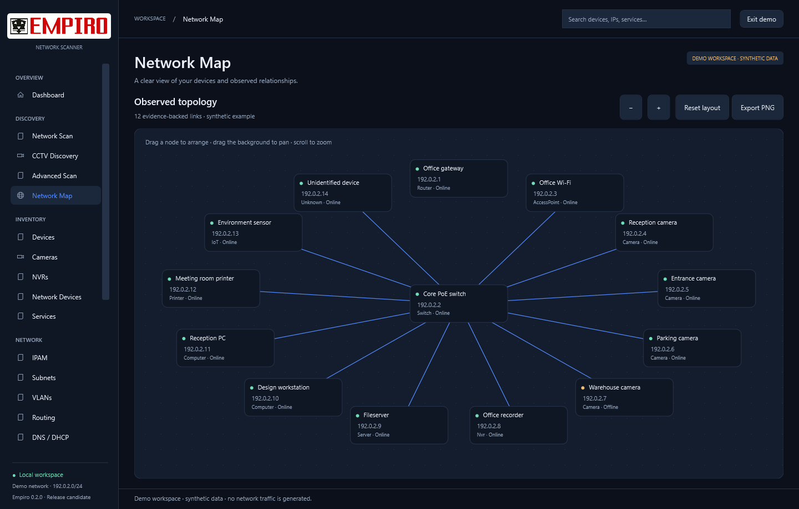
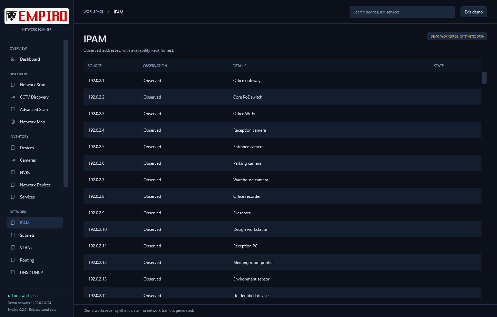
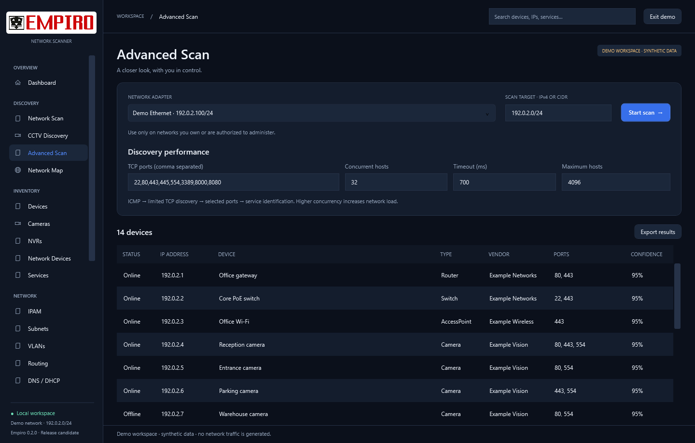

# Five application screenshots

Rendered from the actual WPF interface using 14 synthetic devices. Names, addresses, manufacturers, status and relationship evidence are fictional. The screenshots do not require or expose an office network.

## Dashboard

## CCTV discovery

## Network map

## IPAM

## Advanced scan

